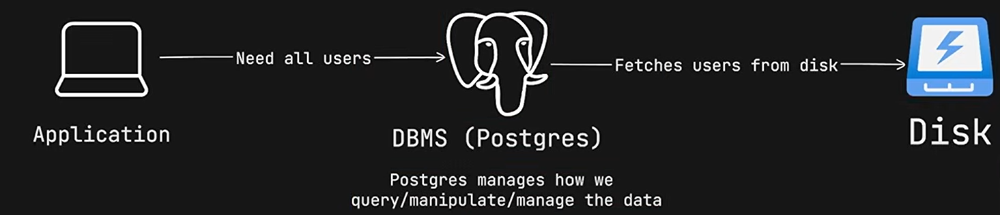

# **<u>SQL</u>** 

## **<u>Data</u>** 

Data is raw, unorganized facts, figures, or symbols that can be collected, stored, and processed. 

On its own, it has no meaning until it is organized and given context (which then becomes _information_ ). 

## **<u>Example of data</u>** 

- "Alice" (a name) 

- 28 (an age) 

- 4500.50 (a salary or balance) 

- "2026-10-21" (a date) 

## **<u>Types of data</u>** 

Data can exist in many types in **SQL** : 

- **Numeric:** 

   - INT (whole numbers) 

   - DECIMAL or FLOAT (numbers with decimals). 

- **Text/String:** 

   - VARCHAR (variable-length text, like names) 

   - CHAR (fixed-length text, like country codes). 

- **Date/Time:** 

   - DATE (YYYY-MM-DD), 

   - TIMESTAMP (date and exact time). 

- **Boolean:** 

   - BOOLEAN (only TRUE or FALSE). 

We need data to make informed decisions, spot trends, solve problems, and track performance. In business and technology, data is the foundation that helps us answer questions like "What sold best last month?" or "Which users are most active?" using tools like SQL. 

- In an application data is continuously created, read, updated and deleted. 

- As an application grows managing large amount of data become difficult in this case we need **<u>Database.</u>** 

## **<u>Database</u>** 

- A database is an organized system for storing and managing data 

- It provides persistent storage for application data 

- Allows us to efficiently create, read, update, and delete data (CRUD operations) 

- Databases can handle large amounts of data and many concurrent users 

- A relational database organizes data into tables consisting of rows and columns 

- Tables can be connected through relationships 

- Examples of relational databases: PostgreSQL, MySQL, Oracle, SQL Server, SQLite 

- The software that manages a database is called a DBMS (Database Management System) and to communicate with this database we need a language that is **<u>SQL</u>** . 

## **<u>SQL</u>** 

- SQL = Structured Query Language. 

- SQL is a language used to communicate with relational databases. 

- It allows us to create, read update, and delete data (CRUD). 

- SQL can also be used to define tables, relationships, constraints, indexes, etc. 

- SQL is primarily a declarative language we tell the database what we want, not exactly how to get it 

- Different database systems may have their own SQL extensions and syntax 
### Example

<mark>SELECT</mark> * <mark>FROM</mark> users <mark>WHERE</mark> age > 23;

